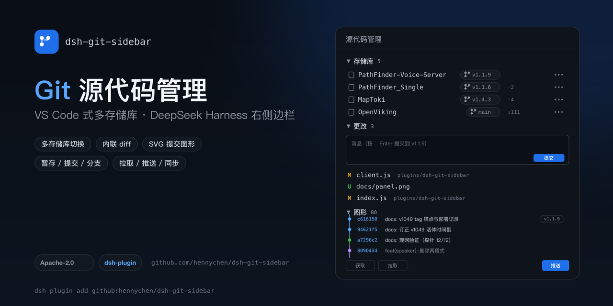
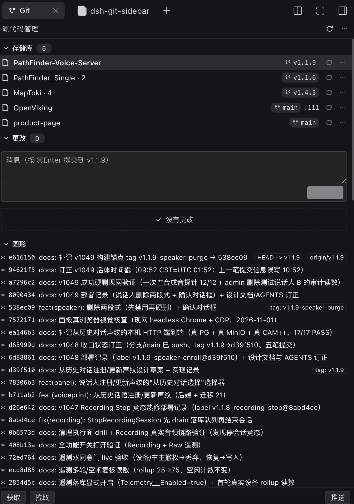

# dsh-git-sidebar

[中文](README.md) | [English](README.en.md)

> 🌐 Project page: <https://hennychen.github.io/dsh-git-sidebar/> · Plugin market index: <https://hennychen.github.io/dsh-git-sidebar/market/index.json>

[](LICENSE)
[](package.json)
[](https://hennychen.github.io/dsh-git-sidebar/market/index.json)



A VS Code **Source Control**–style Git panel that lives in the **right sidebar** of the DeepSeek Harness desktop Web GUI: multi-repository discovery, staging and committing, branches and a commit graph — all in one panel.

## Preview



The panel has three sections, matching VS Code's Source Control layout:

- **Repositories**: Git repositories found in the session directory, nested folders and registered workspaces; branch, ahead/behind, sync and the full repository menu are inline.
- **Changes**: commit box plus **Changes / Staged Changes** groups with per-file stage, discard and inline diffs.
- **Graph**: SVG lane graph, branch multi-select and commit details.

## Features

### Repositories

- Discovers the session directory, nested repositories three levels deep, and registered workspaces (example on this machine: PathFinder-Voice-Server, PathFinder_Single, OpenViking, product-page, MapToki)
- Each row shows the branch pill, `↑ahead ↓behind`, a `⇅` sync button and a `⋯` full Git menu; click the branch pill to switch or create a branch
- An **eye button** in the section header manages visibility: tick repositories on/off, or use **Show all** / **Only with changes**; the header count reads `visible/total`, and the hidden set is remembered per session
- Sorting (discovery time / path / name) and single-vs-multiple repository modes are persisted per session

### Changes

- Commit box with ⌘/Ctrl+Enter; the **split button** offers Commit / Commit All / Commit & Push / Amend Last Commit / Undo Last Commit (changes stay staged)
- **Commit message history**: the last 20 messages per repository, click to fill the box
- **Changes / Staged Changes** groups: stage, unstage and discard per file; inline unified diff (+/- colors, hunk headers, synthesized additions for untracked files)
- **Filter box** for changed files, plus **tree / flat** views
- In multi-repository mode each repository has its own commit box and change list

### Graph

- SVG lane graph: parent links, hollow double-ring merge nodes, latest 200 commits by default
- Branch multi-select: all / current only / local only / remote only / per-branch ticks (tip short hash and “show only this branch”); colored **branch legend**
- **Commit filter** by message / author / hash
- **Click a commit to expand details**: full message, author and time, changed files with +N/-N, per-file diff; checkout the commit (detached HEAD), create a branch from it, or tag it

### Repository operations

Fetch / pull / push / sync, branch checkout, create and delete, stash, tags, worktrees, clone, and a **GIT output** viewer (last 60 commands and their output). Since v0.8.4 the permanent fetch/pull/push footer bar is gone; the actions live on the repository row, in the `⋯` menu and in the graph toolbar.

## VS Code Source Control parity

| VS Code | This plugin |
| --- | --- |
| SOURCE CONTROL header + refresh / more | Same |
| Repository + branch + ahead/behind | Same (click a repository to switch) |
| Commit message box + Commit (⌘Enter) | Same; plus Commit All / Commit & Push / Amend / Undo Last Commit and message history |
| Changes group (stage all / discard all) | Same; per-file stage/discard, filter, tree/flat views |
| Staged Changes group (unstage all) | Same; per-file unstage |
| Click a file to see its diff | Inline unified diff |
| Branch checkout / create branch | Branch list + graph branch multi-select |
| Commit history | Graph + click a commit for details |
| Pull / Push / Sync | Repository row `⇅`, `⋯` menu, graph toolbar |
| Git output | “Show GIT Output” viewer |

Status letters and colors follow VS Code semantics: `M` modified, `A`/`U` added, `D` deleted, `R` renamed, `!` conflicted; file names are colored by extension.

## Install

This repository is a DSH profile bundle (`dsh.bundle.patch` + `dsh.client`); the client half registers the “Source Control” tab in the right sidebar.

```bash
# Option 1: install from GitHub into a profile (pnpm fetches the repository)
dsh plugin --profile desktop add github:hennychen/dsh-git-sidebar

# Option 2: link-mount a local checkout (code changes apply immediately)
dsh plugin --profile desktop add link:/path/to/dsh-git-sidebar
```

After installing, confirm the bundle is enabled under **Settings → Plugins** (the plugin manager's `install_bundle` also registers it), then restart `dsh` once. “Source Control” appears under the right sidebar `+`.

## Opening it

Right sidebar → `+` → **Source Control**.

- If the session directory is a Git repository, it is shown directly;
- if the directory is a **parent of several project repositories**, it scans three levels down, opens the one with the most recent commit and marks it `nested repo`;
- if there is no repository at all, it falls back to the first registered Git workspace and marks it `workspace`;
- click a repository name or branch pill to switch at any time; the choice is stored per session in `localStorage`.

## Plugin market (official format 1 index)

The repository ships a plugin market index that follows the official format; add it as an index source in Discover:

```
https://hennychen.github.io/dsh-git-sidebar/market/index.json
```

Add it under **Settings → Plugins → Experimental plugins → More → Open custom plugin market**, then **Discover → Add index source**. The install confirmation shows the Git source (`hennychen/dsh-git-sidebar`) and the pinned commit.

Index rules (DSH rejects the whole index if any rule is violated):

| Rule | Implementation here |
| --- | --- |
| `format: 1`, UTF-8 JSON, static https, 2xx without redirects | `docs/market/index.json` served by GitHub Pages |
| Every version declares `dsh.bundle` | Every listed tag's `package.json` has `dsh.bundle.patch` |
| Every version has a non-empty `engines.dsh`, copied verbatim | `>=0.2.0-rc.2 <0.3.0` |
| `publishTimestamp` is the commit's committer time (seconds) | Generator runs `git log -1 --format=%ct <commit>` |
| Git source: canonical https URL + 40 lowercase hex commit | `https://github.com/hennychen/dsh-git-sidebar` + tag commit |
| `title` / `description` are LocalizedText including `en` | Bilingual, taken from `locale/*.json` |
| `icon` resolves relative to the index URL over https | `icons/dsh-git-sidebar.svg` |
| Referenced category/label/sortKey must be declared | Only the `development` category is declared and used |

Regenerate the index after a new release:

```bash
git tag v0.8.6
node scripts/market-index.mjs
git add docs/market && git commit -m "chore: update market index"
```

> The package was renamed to `@hennychen/dsh-git-sidebar` in v0.8.1. The generator keys on the newest tag's package name and drops pre-rename versions (`v0.6.4`–`v0.8.0`) so the index never mixes names. `v0.6.1`–`v0.6.3` are skipped because they lack `engines.dsh`.

## Cover variants

| Use | File | Size |
| --- | --- | --- |
| README banner / GitHub social preview | [docs/cover.png](docs/cover.png) | 1280×640 (16:9) |
| 3:2 card (article header, slides) | [docs/cover-3x2.png](docs/cover-3x2.png) | 1200×800 |
| Square (social avatar, chat preview) | [docs/cover-square.png](docs/cover-square.png) | 1080×1080 |

All three are produced by `scripts/make-cover.py` (Pillow): `python3 scripts/make-cover.py docs`. GitHub's social preview has to be uploaded manually under Settings → Social preview (`docs/cover.png`).

## Implementation

- `index.js` — host half. Registers the `/git-sidebar` route; the repository is derived from the session directory (live session → working-directory service, otherwise the `cwd` in the session log header). The `root` parameter only accepts paths inside the session directory or registered workspaces; `execFile` uses fixed argv, validates pathspecs and caps output size.
- `client.js` — client half. Registers the `git` tab type plus a guide card with `sidebarRightTabs.register`, and the panel under `sidebar.right.pane.tab` / `.title`. Rendering is wrapped in an `ErrorBoundary` that shows a visible error card instead of a blank panel.

### Diagnostics

The client posts `op=client-event` heartbeats (mount / paint / apply / info / render-error) to its own host route. When the panel looks blank:

```bash
curl -s 'http://127.0.0.1:<port>/git-sidebar/api?op=client-events&sid=<sessionId>'
curl -s 'http://127.0.0.1:<port>/git-sidebar/api?op=client-asset&sid=<sessionId>'   # is the client module in the boot graph?
```

## Development

The directory is link-mounted in the `desktop` profile:

- after editing `client.js` / `index.js`, disable and re-enable the `@hennychen/dsh-git-sidebar` bundle with `plugin_manager` to hot-reload both halves (no app restart needed);
- the client module id must equal the package name: `@hennychen/dsh-git-sidebar`;
- release flow: bump version → commit → `git tag vX.Y.Z` → `node scripts/market-index.mjs` → commit `docs/market` → push `main` and the tag.

## Changelog

- **v0.8.6** visibility edge cases: selecting a hidden repository reveals it, all-hidden empty states, multi-repo changes follow visibility, stale info responses dropped
- **v0.8.5** per-repository show/hide management (eye button, show all, only with changes)
- **v0.8.4** removed the redundant fetch/pull/push footer bar
- **v0.8.3** fixed white-on-white primary buttons in the dark theme (near-white `brand-primary`)
- **v0.8.2** commit split button (commit all / commit & push / amend / undo), message history, commit details with per-file diff, changes and graph filters
- **v0.8.1** renamed the package to `@hennychen/dsh-git-sidebar` (the unscoped name was taken)
- **v0.8.0** VS Code–style repository menu (commit / changes / pull-push / branch / remote / stash / tag / worktree / clone / GIT output)

## License

[Apache-2.0](LICENSE)
