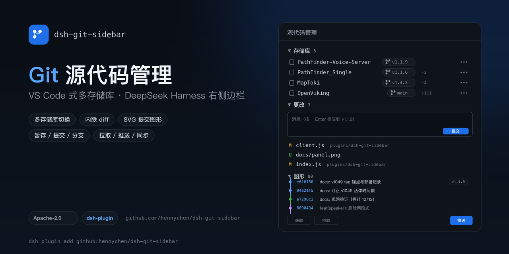
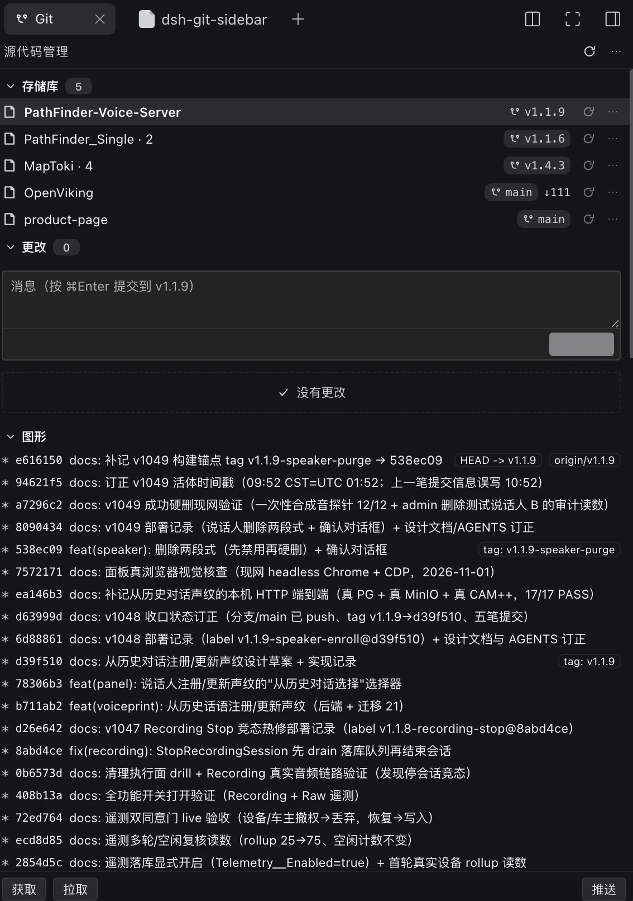

# dsh-git-sidebar



VS Code **Source Control** 风格的 Git 面板，装在 DeepSeek Harness 桌面端 Web GUI 的**右侧边栏**里。

> 封面与预览图由 `scripts/make-cover.py`（Pillow）生成；GitHub 社交预览需在仓库 Settings → Social preview 手动上传 `docs/cover.png`。

## 预览



面板分三段，对齐 VS Code 的 Source Control 布局：

- **存储库**：自动发现会话目录、嵌套仓库与已注册工作区中的 Git 仓库；每行显示分支、领先/落后、同步与仓库菜单（获取/拉取/推送/设为当前），点分支胶囊可切换/新建分支。
- **更改**：当前存储库（多选模式下按仓库分块）的提交框与「更改 / 暂存的更改」分组，支持逐文件暂存、取消暂存、放弃和内联 diff。
- **图形**：提交历史与分支走向（v0.6.2 起为 SVG 车道图）。

## 插件市场（官方索引 format 1）

本仓库自带一份符合官方规范的插件市场索引，可直接作为「发现」的索引源：

```
https://hennychen.github.io/dsh-git-sidebar/market/index.json
```

添加：**设置 → 插件 → 实验性插件 → 更多 → 打开「自定义插件市场」**，然后在 **发现 → 添加索引源** 粘贴上面的 URL。安装确认框会显示 Git 来源（`hennychen/dsh-git-sidebar`）与固定提交。

索引规则对照（DSH 会拒绝违反任意规则的整个索引）：

| 规则 | 本仓库的实现 |
| --- | --- |
| `format: 1`，UTF-8 JSON，静态 https，2xx 无重定向 | `docs/market/index.json`，经 GitHub Pages（`https://hennychen.github.io`） |
| 每个版本声明 `dsh.bundle` | 每个列出的 tag 的 `package.json` 都有 `dsh.bundle.patch` |
| 每个版本 `engines.dsh` 非空且从该版本 manifest 原样复制 | 声明为 `>=0.2.0-rc.2 <0.3.0`，由生成器从 tag 的 manifest 读取 |
| `publishTimestamp` 为该提交的 committer 时间（秒） | 生成器用 `git log -1 --format=%ct <commit>` |
| git source：规范 https URL + 40 位小写 commit，仓库根目录（无 `path`） | `https://github.com/hennychen/dsh-git-sidebar` + tag commit |
| `title` / `description` 为 LocalizedText（必须含 `en`） | 中英双语，取自 `locale/*.json` |
| `icon` 相对索引 URL 解析且为 https（内联 `data:` 时 ≤32 KiB） | `icons/dsh-git-sidebar.svg`（`icon.svg` 副本） |
| 引用的 category/label/sortKey 必须已声明 | 只声明并使用 `development` 分类 |

重新生成索引（新增版本后）：

```bash
git tag v0.6.4            # 先给含 engines.dsh 的版本打 tag
node scripts/market-index.mjs
git add docs/market && git commit -m "chore: update market index"
```

> 生成器会跳过不满足 `dsh.bundle` + `engines.dsh` 的 tag（本仓库 `v0.6.1`–`v0.6.3` 即为这种情况），因此索引只列出 `v0.6.4` 及之后的版本。

## 安装


本仓库是一个 DSH profile bundle（`dsh.bundle.patch` + `dsh.client`），右侧边栏的「源代码管理」标签由客户端半注册。

```bash
# 方式一：从 GitHub 安装到 profile（pnpm 拉取本仓库）
dsh plugin --profile desktop add github:hennychen/dsh-git-sidebar

# 方式二：本地开发挂载（改代码即时生效）
dsh plugin --profile desktop add link:/path/to/dsh-git-sidebar
```

安装后在 **设置 → 插件** 里确认该 bundle 已启用（也可由插件管理器的 `install_bundle` 完成注册），再重启一次 `dsh`。
右侧边栏 `+` 里会出现「源代码管理」。

## 打开

右侧边栏 → `+` → **源代码管理**。侧栏里会有一个 `Git` 标签。

- 若当前会话目录本身是 Git 仓库，直接显示它。
- 若目录只是**包含多个项目仓库的父目录**（例如 `/Users/pm/PathFinder_Source` 下有 `PathFinder_Single`、`PathFinder-Voice-Server`、`OpenViking`、`product-page`），会向下扫描 3 层发现仓库，默认打开**最近有提交**的那个，并在仓库名旁显示 `子目录仓库`。
- 若目录下没有任何仓库，则回退到第一个已注册且是 Git 仓库的工作区（本机为 `/Users/pm/MapToki`），显示 `工作区` 标记。
- 点仓库名 / 分支胶囊可随时在「选择仓库」列表里切换（列表含会话目录、子目录仓库、已注册工作区）；选择按会话记在 `localStorage`。

## 多存储库布局（v0.6）

面板分三段，和 VS Code 左侧 SCM 视图一致：

- **存储库**：自动发现会话目录、其下嵌套仓库、以及已注册工作区里的所有 Git 仓库（本机 5 个：PathFinder-Voice-Server、PathFinder_Single、OpenViking、product-page、MapToki）。每行显示分支、`↑ahead ↓behind`、`⇅同步`、`⋯`（获取/拉取/推送/设为当前）；点分支胶囊可切换/新建分支。
- **更改**：单选模式下显示当前存储库的提交框 + 更改/暂存分组；多选模式下按存储库分块，每块有自己的提交框和改动列表。
- **图形**：`git log --graph --all` 的提交图形（graph 字符 + hash + subject + refs）。

顶部 `⋯` 菜单：存储库选择（单个/多个）、排序（发现时间/路径/名称）、分区显示开关、刷新全部。选择与模式按会话记在 localStorage。

## 功能（对照 VS Code Source Control）

| VS Code | 本插件 |
| --- | --- |
| SOURCE CONTROL 标题栏 + 刷新 / 更多 | 同左 |
| 仓库 + 分支 + ahead/behind | 同左（点仓库名切换仓库） |
| 提交信息框 + Commit（⌘Enter） | 同左，仅在已暂存且有信息时可用 |
| Changes 分组（暂存全部 / 放弃全部） | 同左，可折叠，含逐文件 `+` 暂存与 `↺` 放弃 |
| Staged Changes 分组（全部取消暂存） | 同左，可折叠，含逐文件 `−` |
| 点击文件看 diff | 行内展开统一 diff（+/- 着色、hunk 头、未跟踪文件合成新增 diff） |
| 分支切换 / 新建分支 | 分支列表勾选当前分支，点击切换（确认）；`+` 新建 |
| Commit 历史 | 最近 20 条，可折叠 |
| Pull / Push / Sync | 底部 获取 / 拉取 / 推送，`⋯` 菜单含 同步 |

状态字母与配色沿用 VS Code 语义：`M` 修改（warn）、`A`/`U` 新增（success）、`D` 删除（error）、`R` 重命名（brand）、`!` 冲突（error）；文件名按扩展名着色（Seti 风格）。

## 实现

- `index.js`：宿主半。注册 `/git-sidebar` 路由，仓库由会话目录推导（活动会话 → 工作目录服务；否则 → 会话日志 header 的 `cwd`），`root` 参数只接受会话目录或已注册工作区内的路径。`execFile` 固定 argv、校验 pathspec、限制输出大小。
- `client.js`：客户端半。用 `sidebarRightTabs.register` 注册 `git` 类型 + guide 卡片，在 `sidebar.right.pane.tab` / `.title` 注册面板。渲染包在 `ErrorBoundary` 里，失败时显示可见错误卡而不是空白。

### 自诊断

客户端会向自身宿主路由发 `op=client-event` 心跳（mount / apply / auto-pick / info / render / render-error）。排查"面板空白"时可读：

```bash
curl -s 'http://127.0.0.1:<port>/git-sidebar/api?op=client-events&sid=<sessionId>'
curl -s 'http://127.0.0.1:<port>/git-sidebar/api?op=client-asset&sid=<sessionId>'   # 客户端模块是否在 boot graph
```

## 开发

目录以 `link:` 方式挂在 `desktop` 配置里：

- 改 `client.js` / `index.js` 后，用 `plugin_manager` 把 `dsh-git-sidebar` 的 bundle 关再开，即可热重载客户端与宿主模块（不必重启 App）。
- 客户端模块 id 必须等于包名：`dsh-git-sidebar`。
